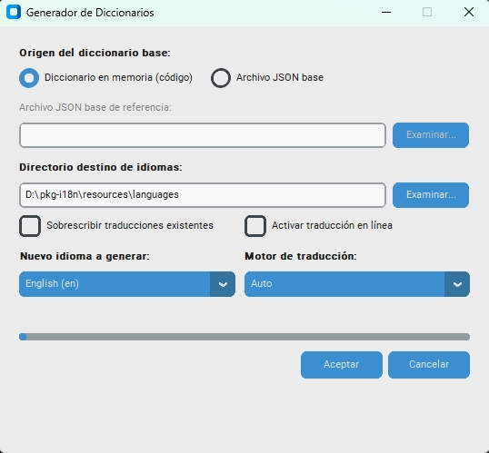

# 🌐 pkg-i18n

[🇪🇸 Español](README.md) | [🇺🇸 English](README.en.md)

[](LICENSE) [](https://www.python.org/) [](#️-7-layer-cascade-loading-architecture--contingency) [](#-installation)

This package provides a comprehensive, centralized, extensible, high-performance **internationalization (i18n) and localization (l10n)** solution with zero mandatory runtime dependencies for any Python project (desktop applications such as PyQt/CustomTkinter, CLI tools, scripts, or web servers).

**pkg-i18n** is the core internationalization and localization infrastructure used across the **Asisnet** application suite.

--------------------------------------------------------------------------------

#### 📋 Table of Contents

1. [🎯 Why pkg-i18n? (Purpose and Intent)](#-why-pkg-i18n-purpose-and-intent)
2. [🚀 Key Capabilities and Features](#-key-capabilities-and-features)
3. [📦 Installation](#-installation)
4. [🏗️ 7-Layer Cascade Loading Architecture + Contingency](#️-7-layer-cascade-loading-architecture--contingency)
5. [📁 Project Structure and JSON File Format](#-project-structure-and-json-file-format)
6. [🛠️ Developer Quickstart Guide](#️-developer-quickstart-guide)
   - [Block I: Code-Based Foundation (Layer 0 — Pre-Production)](#block-i-code-based-foundation-layer-0--pre-production)
     - [1. Registering the Base Dictionary in Code (Layer 0)](#1-registering-the-base-dictionary-in-code-layer-0)
     - [2. Configuring and Resolving Language Paths](#2-configuring-and-resolving-language-paths)
   - [Block II: Runtime Operations (Production)](#block-ii-runtime-operations-production)
     - [3. Initialization and Basic Consumption (`t18n`)](#3-initialization-and-basic-consumption-t18n)
     - [4. Web Concurrency, ContextVar and Request Isolation (FastAPI, Uvicorn, Flask, Threads)](#4-web-concurrency-contextvar-and-request-isolation-fastapi-uvicorn-flask-threads)
     - [5. Real-Time UI Subscriptions (Observer Pattern)](#5-real-time-ui-subscriptions-observer-pattern)
     - [6. Listing and Managing Available Languages](#6-listing-and-managing-available-languages)
   - [Block III: Development Tools and Utilities](#block-iii-development-tools-and-utilities)
     - [7. AST + Regex Syntactic Extractor (`extract_base_language`)](#7-ast--regex-syntactic-extractor-extract_base_language)
     - [8. Synchronization and Automated Translation (`prepare_new_language`)](#8-synchronization-and-automated-translation-prepare_new_language)
     - [9. Graphical Interface: Dictionary Generator (`--ui`)](#9-graphical-interface-dictionary-generator---ui)
     - [10. Active Dictionary Export (`export_active_dictionary`)](#10-active-dictionary-export-export_active_dictionary)
     - [11. Packaging Support with PyInstaller](#11-packaging-support-with-pyinstaller)
7. [🌐 Interoperability with Other Languages](#-interoperability-with-other-languages)
8. [👥 Contact and Support](#-contact-and-support)
9. [📄 License](#-license)

--------------------------------------------------------------------------------

#### 🎯 Why pkg-i18n? (Purpose and Intent)

In enterprise and mission-critical software engineering, managing multilingual text often degrades into a **repetitive, unorganized, and failure-prone task**:
*   **Hardcoded strings in source code**: Text embedded directly inside GUI views or business logic makes audits, regional adaptations, and locale switching difficult.
*   **Heavy and rigid dependencies**: Traditional tools requiring compilation of binary catalogs (.mo, .po) or binding projects to complex third-party packages incompatible with lightweight or embedded environments.
*   **Runtime inconsistencies and crashes**: Lack of deterministic fallback safety nets when keys are missing from outdated catalogs, causing unhandled runtime crashes in front of end users.
*   **Corruption during automated translation**: Loss of dynamic variables (`{user}`), HTML tags, or URLs when raw plain text is sent to external machine translation services.
*   **Cross-platform isolation**: Difficulty in sharing a single terminology catalog between modern Python microservices/apps and established enterprise desktop systems in other languages (such as .NET / VB.NET).

**pkg-i18n was built to eliminate these problems once and for all**, delivering a **turnkey, modular, resilient, and high-performance solution**:
1.  **Single-Line Resolution (`t18n`)**: Instant lookups with dot-notation path resolution and a completely transparent contingency safety net.
2.  **7-Layer Cascade Loading + Contingency**: Seamlessly overrides from in-code defaults to packaged catalogs and external, user-editable files, backed by an ultimate fallback that guarantees zero crashes in production.
3.  **Minimal Footprint in Production ($O(1)$)**: Ultra-lightweight memory profile using `__slots__ = True`, direct $O(1)$ dispatch, lazy loading (PEP 562), and zero mandatory third-party runtime dependencies (100% Python standard library).
4.  **Asynchronous and Multi-Threaded Concurrency Safety**: Total language isolation per HTTP request, background task, or thread via `ContextVar` (`use_language`), enabling web services (FastAPI, Uvicorn, Flask, Celery) to serve multiple users in different languages simultaneously with an in-memory multi-language cache and zero race conditions.
5.  **Smart Machine Translation with Safe Masking**: Streamlined catalog creation protecting variables, line breaks, and HTML syntax against external translation hallucinations or corruption.
6.  **Open and Interoperable Ecosystem**: Standard JSON format readily consumable both within Python and across corporate .NET / VB.NET applications.

--------------------------------------------------------------------------------

#### 🚀 Key Capabilities and Features

*   **Minimal Footprint and Standalone in Production**: Operates with a minimal footprint consuming exclusively the Python standard library (`json`, `re`, `logging`, `pathlib`). Importing (`import i18n` or `from i18n import t18n`) only loads the essential engine (`i18n.engine`) with memory-optimized structures (`__slots__ = True`), ensuring zero overhead and no third-party runtime dependencies.
*   **Concurrency Safety and Context Isolation (`ContextVar`)**: Native support for asynchronous web servers and concurrent architectures (FastAPI, Starlette, Uvicorn, Flask, Celery, ThreadPoolExecutor). Isolates language context per HTTP request or coroutine without mutating global application state via `use_language()` and `set_context_language()`.
*   **In-Memory Multi-Language Cache ($O(1)$) and Targeted Lookups (`lang`)**: In-memory retention of resolved dictionaries per language (`_loaded_languages`), eliminating redundant disk reads. Additionally allows direct $O(1)$ lookups in a specific language using the `lang` parameter in `t18n("key", lang="en")` without changing the global active language.
*   **Modular Section Registration (`register_section_defaults`)**: Granular registration of code-level defaults (Layer 0) per decoupled section or module without manually nesting dictionaries.
*   **Integrated Graphical Interface: Dictionary Generator (`i18n --ui`)**: Modern, intuitive UI (CustomTkinter) to create, clone, and synchronize language dictionaries with support for automated online translation (Google Translate —requires active Internet connection—) and local offline engines (Argos Translate and local structured cloning without connection).
*   **Ultra-Fast Hierarchical Cascade Resolution (7 Layers)**: Merges dictionaries in memory by combining in-code defaults (Layer 0), packaged base catalogs (`es.json`), regional variants (`pt-BR.json`), and custom external layers.
*   **Runtime Contingency Safety Net**: If a key is missing from all catalog layers, `t18n(key, default_text)` formats and delivers the supplied default text, guaranteeing uninterrupted operational continuity.
*   **Direct Dot-Notation Access and `_default` Section**: Supports direct root keys (e.g., `t18n("btn_open")` resolves `_default.btn_open`) as well as modular nested paths (e.g., `t18n("module1.sec1.key")`).
*   **Safe Dynamic Parameter Formatting**: Variable interpolation using standard syntax (`"Welcome, {user}"`) with tolerance and protection against formatting errors.
*   **Observer Pattern for User Interfaces**: Reactive subscription via `i18n.subscribe(callback)` to dynamically refresh windows and views upon language change without restarting the application.
*   **AST + Regex Syntactic Extractor (`extract_base_language`)**: Scans project source code to automatically catalog keys and generate both the production base dictionary and line-by-line source audits (`es_source.json`).
*   **Automated Translation with Anti-Hallucination Masking (`prepare_new_language`)**: Masks variables (`{user}`), HTML tags, and URLs with secure numerical tokens prior to invoking translation engines (Google Translate / Argos Translate / Mock), restoring them intact at destination.
*   **Native Support for PyInstaller Bundles**: Automatic detection of frozen execution environments (`sys._MEIPASS`) to locate packaged resources without extra configuration.
*   **Interoperability with .NET and VB.NET Systems**: Open design to share catalogs and internationalize enterprise software across multiple programming stacks.

--------------------------------------------------------------------------------

#### 📦 Installation

##### 1. Direct Installation via GitHub (Recommended)
Install directly into your virtual environment using pip:
```powershell
pip install git+https://github.com/borispinto/pkg-i18n.git
```
Or declare it in your `requirements.txt`:
```text
pkg-i18n @ git+https://github.com/borispinto/pkg-i18n.git
```
Or in your `pyproject.toml`:
```toml
[project]
dependencies = [
    "pkg-i18n>=1.0.0",
]
```

--------------------------------------------------------------------------------

##### 2. Installation from Local Source Code
Clone and standard installation:
```powershell
git clone https://github.com/borispinto/pkg-i18n.git
cd pkg-i18n
pip install .
```
Or in editable mode for active development:
```powershell
pip install -e .
```

>[!NOTE] **Dependency and Profile Separation**:
>*   **Production / Runtime Consumption (`t18n`)**: Operates as a **minimal resource with zero external dependencies** (requires only Python 3.8+ and its standard library).
>*   **Graphical Interface (`--ui`) & Automated Translation (Development / Tooling)**:
>    *   To launch the graphical interface (`i18n --ui`): `pip install customtkinter pillow`
>    *   For online machine translation with **Google Translate** (requires active Internet connection): `pip install deep-translator`
>    *   For **100% offline** neural translation with **Argos Translate** (no internet needed once language models are present): `pip install argostranslate`

--------------------------------------------------------------------------------

#### 🏗️ 7-Layer Cascade Loading Architecture + Contingency

The `I18nManager` resolves translations by evaluating 7 hierarchical layers in ascending order (each higher layer overrides earlier ones if defining the same key):

| Layer | Source | Description |
| :--- | :--- | :--- |
| **0** | Python Code | Base dictionary in source code, loaded via `register_defaults()` |
| **1** | Internal `es.json` | Packaged default base language bundled inside the application |
| **2** | External `es.json` | Base language file in user-editable external directory |
| **3** | Internal `{lang_base}.json` | Requested base language (e.g., `pt.json`) bundled internally |
| **4** | External `{lang_base}.json` | Requested base language file from external directory (e.g., user's `pt.json`) |
| **5** | Internal `{lang_regional}.json` | Requested regional variant (e.g., `pt-BR.json`) bundled internally |
| **6** | External `{lang_regional}.json` | Requested regional variant from external directory (e.g., user's `pt-BR.json`) |
| 🟡 **Contingency** | In-code `t18n('key', 'default')` | Ultimate runtime safety net: catches catalog discrepancies and guarantees total operational continuity |

--------------------------------------------------------------------------------

#### 📁 Project Structure and JSON File Format

##### Recommended consumer project layout
```text
my_project/
├── pyproject.toml / requirements.txt   # Declares dependency on pkg-i18n
├── src/
│   ├── app.py                         # Your application source code
│   └── ...
└── resources/
    └── languages/                     # Canonical path for language catalogs
        ├── es.json                    # Base language
        ├── en.json                    # English language
        ├── pt.json                    # Secondary language
        └── pt-BR.json                 # Regional variants
```
>[!NOTE] The i18n engine automatically discovers the `resources/languages` folder in your project root, current working directory (CWD), or bundled inside PyInstaller executables.

##### JSON Language File Format
In accordance with engine specifications, **reserved keys with a leading underscore `_` at root** are:
*   `_language_name`: Used to render human-readable language names in UI selectors.
*   `_default`: Reserved section holding all general/global keys.

Canonical sorting places `_language_name` first, followed by `_default`, and subsequently application submodules or sections alphabetically:
```json
{
    "_language_name": "Español",
    "_default": {
        "app_title": "My Python Application",
        "btn_open": "Abrir",
        "btn_save": "Guardar",
        "msg_welcome": "Bienvenido, {user}"
    },
    "module1": {
        "sec1": {
            "username_field": "Nombre de usuario",
            "section_key": "Valor en Sección 1"
        }
    }
}
```

--------------------------------------------------------------------------------

#### 🛠️ Developer Quickstart Guide

This guide organizes **pkg-i18n** capabilities in their natural logical sequence of occurrence:
1. **Block I: Code-Based Foundation (Layer 0 — Pre-Production)**: Ensures full resilience, zero-latency startup, and establishes the in-memory foundation for generating new catalogs.
2. **Block II: Runtime Operations (Production)**: Covers daily text lookups, variable formatting, web concurrency, and reactive UI updates.
3. **Block III: Development Tools and Utilities**: Automates string extraction, assisted translation, graphical tooling, and binary packaging.

--------------------------------------------------------------------------------

### Block I: Code-Based Foundation (Layer 0 — Pre-Production)

##### 1. Registering the Base Dictionary in Code (Layer 0)
###### Why is it necessary and highly recommended before production?
**Layer 0** is the cornerstone of the **pkg-i18n** contingency architecture. Registering base strings directly in Python source code via `register_defaults()` or `register_section_defaults()` provides critical deterministic advantages:
*   **Total Autonomy and Resilience**: If external `.json` files are not deployed, accidentally deleted by end users, or encounter file permission issues, the application continues running with 100% of its base strings intact and visible, preventing broken views or empty text labels.
*   **Zero I/O Latency at Startup**: General and critical UI strings reside directly in memory upon startup, eliminating disk reading delays and JSON parsing overhead.
*   **In-Memory Foundation for New Dictionaries**: The registered dictionary serves as the `default_dict` in memory feeding both synchronization pipelines (`prepare_new_language`) and the graphical interface (`i18n --ui`), enabling generation, cloning, and translation of new languages without requiring a pre-existing `.json` file on disk.
*   **Pre-Release Best Practice**: Prior to freezing binaries with PyInstaller or deploying to production, it is recommended to run the extractor (`extract_base_language`) and freeze consolidated strings into source code as Layer 0.

```python
from i18n import get_i18n_instance, register_defaults, register_section_defaults

i18n = get_i18n_instance()

# 1. Complete global registration of the base catalog (Layer 0):
register_defaults({
    "_language_name": "Español",
    "_default": {
        "app_title": "Mi Aplicación Python",
        "btn_accept": "Aceptar",
        "btn_close": "Cerrar",
        "btn_continue": "Continuar"
    },
    "modulo1": {
        "clave_1": "Texto de la clave 1 del modulo1.",
        "clave_2": "Texto de la clave 2 del modulo1.",
    }
})

# 2. Granular registration for decoupled modules (direct or via canonical function):
register_section_defaults("auth", {
    "login": "Iniciar Sesión",
    "logout": "Cerrar Sesión",
    "btn_submit": "Enviar credenciales"
})
```

--------------------------------------------------------------------------------

##### 2. Configuring and Resolving Language Paths
`pkg-i18n` allows inspecting and customizing directory paths for internal (bundled resources) and external (user-editable) language files:

```python
from i18n import get_i18n_instance, resolve_languages_directory

# Resolve active canonical path (CWD, package resources, or PyInstaller sys._MEIPASS):
path = resolve_languages_directory()

# Customize internal and external directories:
i18n = get_i18n_instance()
i18n.set_internal_languages_dir("resources/languages")
i18n.set_external_languages_dir("external/languages")
```

--------------------------------------------------------------------------------

### Block II: Runtime Operations (Production)

##### 3. Initialization and Basic Consumption (t18n)
You can invoke the canonical `t18n()` function anywhere in your project with immediate $O(1)$ resolution:

```python
from i18n import t18n

# 1. Keys from the _default section (both syntaxes are equivalent and resolve in O(1)):
button_text = t18n("btn_open", "Abrir")
save_text = t18n("_default.btn_save", "Guardar")

# 2. Nested modular section keys:
section_title = t18n("modulo1.sec1.clave_valor", "Valor por Defecto")

# 3. Safe dynamic variable interpolation:
message = t18n("msg_welcome", "Bienvenida, {user}", user="Dayana")

# 4. Fallback marker control (<Default Text>) for missing keys:
# By default, a missing key returns '<Default Text>' to alert developers.
# To suppress markers '< >' and obtain clean text:
clean_text = t18n("msg_welcome", "Bienvenida, {user}", user="Dayana", suppress_markers=True)

# 5. Direct lookup in a specific language (without altering context or global language):
# Resolves 'btn_open' from en.json ('Open'); if missing, delivers the base fallback 'Abrir':
text_en = t18n("btn_open", "Abrir", lang="en")
```

>[!NOTE] **Direct Dictionary Access and Key Checking**:
>`I18nManager` supports dictionary-like syntax to check key existence or access raw values:
>```python
>from i18n import get_i18n_instance
>i18n = get_i18n_instance()
>
># Existence check (O(1)):
>if "btn_open" in i18n:           # or i18n.has_key("btn_open")
>    print(i18n["btn_open"])      # Bracket access (raises KeyError if key is missing)
>    print(i18n.get("btn_open"))  # Safe access without formatting
>```
>**Production Recommendation**: Always prefer the canonical `t18n()` function over direct access. Unlike raw lookups, `t18n()` provides tolerant variable formatting, 7-layer contingency evaluation, `ContextVar` isolation, and clean marker suppression.

--------------------------------------------------------------------------------

##### 4. Web Concurrency, ContextVar and Request Isolation (FastAPI, Uvicorn, Flask, Threads)
###### Why is it useful?
In web architectures, REST APIs, microservices, and asynchronous task workers (FastAPI, Starlette, Uvicorn, Flask, Celery, ThreadPoolExecutor), a single process handles multiple concurrent requests in parallel for users with different language preferences. Mutating the global application language (`set_language(...)`) would alter state across all concurrent users, causing race conditions and delivering text in the wrong language.

`pkg-i18n` provides a native solution based on **context variables (`contextvars.ContextVar`)**, guaranteeing that each asynchronous coroutine or thread retains its active language strictly isolated without memory leaks or race conditions.

###### How to use it?

1. **Context Manager `use_language` (Scoped Blocks)**:
   Temporarily isolates a language within any task, thread, or code block:
   ```python
   from i18n import t18n, use_language

   # use_language("en") resolves 'btn_open' from en.json ('Open'):
   with use_language("en"):
       print(t18n("btn_open", "Abrir"))
   ```

2. **HTTP Middleware for Web Servers (FastAPI / Starlette / Uvicorn)**:
   Extracts user locale from request headers (`Accept-Language`) or query parameters and associates it with the coroutine context:
   ```python
   from fastapi import FastAPI, Request
   from i18n import set_context_language, reset_context_language, t18n

   app = FastAPI()

   @app.middleware("http")
   async def i18n_middleware(request: Request, call_next):
       # Extract base language code (e.g., 'en', 'es', 'pt')
       lang_header = request.headers.get("accept-language", "es")
       lang_code = lang_header.split(",")[0].split("-")[0].strip()

       # Set language in the current task's ContextVar
       token = set_context_language(lang_code)
       try:
           response = await call_next(request)
           return response
       finally:
           # Cleanly reset context after request completion
           reset_context_language(token)

   @app.get("/welcome")
   async def welcome(name: str = "User"):
       # Resolves automatically in the language assigned to the active request:
       return {"message": t18n("msg_welcome", "Bienvenido, {user}", user=name)}
   ```

3. **Thread Isolation (`ThreadPoolExecutor`)**:
   ```python
   from concurrent.futures import ThreadPoolExecutor
   from i18n import t18n, use_language

   def english_task():
       # use_language("en") resolves 'btn_open' from en.json ('Open')
       with use_language("en"):
           return t18n("btn_open", "Abrir")

   def spanish_task():
       # use_language("es") resolves 'btn_open' from es.json ('Abrir')
       with use_language("es"):
           return t18n("btn_open", "Abrir")

   with ThreadPoolExecutor(max_workers=2) as executor:
       future_en = executor.submit(english_task)
       future_es = executor.submit(spanish_task)
       print(f"Result EN: {future_en.result()} | ES: {future_es.result()}")
   ```

>[!TIP] **Recommendation for the AST Syntactic Extractor (`extract_base_language`)**:
>In calls to `t18n(key, default_text)`, consistently use the fallback string corresponding to the base language (e.g., `"Abrir"`), even when operating within `use_language("en")` blocks or passing `lang="en"`. The `pkg-i18n` engine resolves the target translation from the appropriate catalog in memory; maintaining a uniform default string across your codebase prevents catalog ambiguity and ensures `extract_base_language` builds a clean, deterministic base catalog (`es.json`).

4. **Deterministic Resolution Hierarchy ($O(1)$)**:
   When calling `t18n(key, ...)` or verifying with `has_key(key, ...)`, resolution executes in constant $O(1)$ time evaluating sources in strict precedence order:
   1. **Explicit parameter `lang`**: If specified (`t18n(..., lang="fr")`), resolves directly against that catalog.
   2. **Active Context (`ContextVar`)**: If set via `use_language()` or `set_context_language()`, resolves in that context.
   3. **Global Active Language (`self.active_dictionary`)**: The language set with `set_language(...)` (ideal for desktop GUI/CLI apps).
   4. **Contingency Safety Net**: If missing across all catalogs, returns the formatted `default_text`.

5. **In-Memory Multi-Language Cache ($O(1)$) and `clear_cache()`**:
   - `_loaded_languages`: `I18nManager` retains in memory every dictionary resolved across the 7 layers. Once compiled, subsequent queries resolve directly in $O(1)$ without disk access.
   - If `.json` files are modified at runtime, invoke `clear_cache()` to flush memory and force immediate reload:
     ```python
     from i18n import clear_cache

     # Flush in-memory cache of pre-loaded dictionaries
     clear_cache()
     ```

--------------------------------------------------------------------------------

##### 5. Real-Time UI Subscriptions (Observer Pattern)
For desktop UI applications (CustomTkinter, PyQt, PySide, Tkinter, WxPython), register subscriber callbacks to refresh interfaces dynamically whenever the user switches language:
```python
from i18n import get_i18n_instance, t18n

i18n = get_i18n_instance()

def on_language_changed(new_language_code: str):
    print(f"Language switched to: {new_language_code}")
    # Refresh GUI widgets
    lbl_title.configure(text=t18n("app_title", "Mi Aplicación"))
    btn_open.configure(text=t18n("btn_open", "Abrir"))

# Subscribe callback
i18n.subscribe(on_language_changed)

# Switching language triggers on_language_changed automatically:
i18n.set_language("pt-BR")
```

--------------------------------------------------------------------------------

##### 6. Listing and Managing Available Languages
To populate dropdowns or combo boxes in your user interface:
```python
from i18n import get_i18n_instance

i18n = get_i18n_instance()

# Obtain list of dictionaries: [{'code': 'es', 'name': 'Español'}, ...]
languages_list = i18n.get_available_languages()

# Obtain mapping by display name: {'Español': 'es', 'Português (Brasil)': 'pt-BR'}
languages_dict = i18n.get_available_languages(by_name=True)
```

--------------------------------------------------------------------------------

### Block III: Development Tools and Utilities

##### 7. AST + Regex Syntactic Extractor (extract_base_language)
Scans your project source code searching for `t18n()` invocations and generates or updates `es.json` while preserving and ordering keys. If `output_dir` is omitted, it defaults to `resources/languages` relative to `origin_dir`:
```python
from i18n import extract_base_language

result = extract_base_language(
    origin_dir="src",                      # Folder or source file to scan
    output_dir=None,                       # Optional (defaults to src/resources/languages)
    file_extensions=[".py", ".html"],      # File extensions to scan
    recursive=True,                        # Scan subdirectories recursively
    function_names=["t18n"],               # Function names to detect
    language_name="Español",
    target_filename="es.json",
    show_source=True                       # Generates standard es.json AND audit es_source.json
)

print(result)
# {
#   'status': 'success',
#   'target_file': '.../resources/languages/es.json',
#   'source_file': '.../resources/languages/es_source.json',
#   'total_extracted': 15,
#   ...
# }
```
>[!TIP] **Dual Generation with show_source=True**:
>1. `es.json` (Production): Contains clean strings for production runtime (`"btn_open": "Abrir"`).
>2. `es_source.json` (Audit / Development): Contains values and program source file line mappings:
>```json
>"btn_open": {
>    "valor": "Abrir",
>    "source": {
>        "src/gui/main_window.py": [50, 520],
>        "src/gui/second_window.py": [3, 8, 25]
>    }
>}
>```

--------------------------------------------------------------------------------

##### 8. Synchronization and Automated Translation (prepare_new_language)
Creates or synchronizes templates for other languages (e.g., `en.json`, `pt.json`, `fr.json`) based on `es.json` or an in-memory dictionary (`default_dict`). If `target_dir` is not specified, it resolves automatically via `resolve_languages_directory()`:
```python
from i18n import prepare_new_language

# Example 1: Automated machine translation using Google Translate (requires deep-translator & internet)
result = prepare_new_language(
    target_code="fr",
    target_name="Français",
    default_dict={},                      # Optional dictionary if no es.json is present
    base_code="es",
    target_dir=None,                      # Optional (defaults to resources/languages)
    auto_translate=True,                  # Translate missing strings automatically
    engine="auto"                         # Options: 'auto', 'google', 'argos', 'none', 'mock'
)

# Example 2: Generate base template without external translation (offline/local structured cloning)
result_offline = prepare_new_language(
    target_code="en",
    target_name="English",
    auto_translate=False,
    engine="none"
)
```

--------------------------------------------------------------------------------

##### 9. Graphical Interface: Dictionary Generator (`--ui`)
`pkg-i18n` incorporates an interactive, assisted graphical interface for creating, cloning, and synchronizing language dictionaries without manually editing JSON files.



###### Interface Highlights:
*   **Dynamic Base Source Selector**: Toggle between the in-memory dictionary from source code (`default_dict`) or interactively choose an existing JSON file on disk.
*   **Normalized Target Language Catalog**: Built-in language catalog with standardized codes and readable display names.
*   **Multi-Engine Support and Connectivity**:
    *   **Google Translate (`google` / `auto`)**: High-accuracy neural translation. **Requires active Internet connection**.
    *   **Argos Translate (`argos`)**: Local neural inference based on CTranslate2 with offline models (`languages/argos`). **100% offline** (no internet needed once models are installed).
    *   **Structured Cloning (`none`)**: Duplicates catalog structure preserving base text for manual editing. **100% offline** with zero external dependencies.
*   **Visual Harmony and Theming**: Built with CustomTkinter, supporting light/dark appearance modes and custom theme palettes.

###### CLI Launch:
```powershell
# Launch interface in standalone mode
i18n --ui

# Launch with target directory and initial base file
i18n --ui --target-dir resources/languages --base resources/languages/es.json

# Execute as Python module
python -m i18n --ui
```

###### Programmatic Invocation from Python Code:
Integrate directly into desktop applications (PyQt, CustomTkinter, Tkinter, etc.) as a subordinate modal dialog (`modal`) or standalone window:

```python
from i18n import launch_new_language_dialog

# Launch as standalone main window or integrated modal dialog
dialog = launch_new_language_dialog(
    parent=None,                                # None for standalone window, or root / parent toplevel
    target_dir="resources/languages",          # Folder where the new language JSON will be saved
    base_code="es",                            # Base language reference code
    base_file="resources/languages/es.json",   # Optional path to base JSON file on disk
    default_dict=my_code_dictionary,           # Base dictionary in memory (Layer 0 in code)
    icon_path="assets/icon.ico",               # Window title bar icon
    theme="blue",                              # CustomTkinter color theme ('blue', 'green', etc.)
    appearance_mode="dark",                    # Appearance mode ('dark', 'light', 'system')
    font_family="Segoe UI",                    # General typography
    font_size=11,                              # Base font size in points (scales harmoniously)
    fonts=None,                                # Granular dictionary of fonts per UI role
    colors=None,                               # Granular dictionary of colors for UI palette
    on_success=lambda path: print(f"Created: {path}"), # Callback executed upon successful creation
    on_error=lambda err: print(f"Error: {err}")        # Callback on exceptions
)
```

###### Exhaustive Parameter Reference (`launch_new_language_dialog`):

| Parameter | Type | Default Value | Description |
| :--- | :--- | :--- | :--- |
| `parent` | `Optional[Any]` | `None` | Parent window (`Tk`, `CTk`, or `CTkToplevel`). If `None`, instantiates as independent window (`CTk`) with its own event loop (`mainloop`). If provided, operates as a modal dialog centered over the parent (`transient` / `grab_set`). |
| `target_dir` | `Optional[str]` | `None` | Destination directory for `.json` dictionaries. If omitted, resolves automatically via `resolve_languages_directory()`. |
| `base_code` | `Optional[str]` | `None` | Base language reference code (e.g., `"es"`). Defaults to base language configured in global `i18n` instance. |
| `base_file` | `Optional[str]` | `None` | Path to existing base `.json` file. If provided, pre-selects the "Base JSON file" option. |
| `default_dict` | `Optional[Dict[str, Any]]` | `None` | In-memory base dictionary (Layer 0 in code). If supplied, enables "In-memory dictionary (code)" allowing direct translation without requiring a disk file first. |
| `icon_path` | `Optional[str]` | `None` | Path to `.ico` file for window title bar. |
| `theme` | `Optional[str]` | `None` | CustomTkinter color theme (e.g., `"blue"`, `"dark-blue"`, `"green"`, or path to a custom theme `.json`). |
| `appearance_mode` | `Optional[str]` | `None` | Appearance mode: `"dark"`, `"light"`, or `"system"`. Inherits parent application mode if omitted. |
| `font_family` | `Optional[str]` | `None` | Font family for interface text (e.g., `"Segoe UI"`, `"Roboto"`, `"Arial"`). Adopts active theme font if omitted. |
| `font_size` | `Optional[int]` | `11` | Base font size in points. Harmoniously scales titles, labels, entries, and buttons. |
| `fonts` | `Optional[Dict[str, Any]]` | `None` | Granular typography customization per role (`"title"`, `"label"`, `"body"`, `"entry"`, `"button"`, `"status"`), accepting `CTkFont` instances or `(family, size, weight)` tuples. |
| `colors` | `Optional[Dict[str, Any]]` | `None` | Custom color palette dictionary (`"text_primary"`, `"text_muted"`, `"btn_accept_fg"`, `"btn_cancel_fg"`, `"btn_browse_fg"`, `"progressbar_fg"`). |
| `on_success` | `Optional[Callable[[str], None]]` | `None` | Callback invoked upon successful file generation, receiving absolute file path (`file_path`). |
| `on_error` | `Optional[Callable[[Exception], None]]` | `None` | Callback invoked in case of error or exception during generation or translation. |

--------------------------------------------------------------------------------

##### 10. Active Dictionary Export (export_active_dictionary)
Exports the active in-memory dictionary (`active_dictionary`) exactly as resolved after applying all layers to a JSON file:
```python
from i18n import export_active_dictionary, get_i18n_instance

# 1. Export with default path ('dictionary.json' in current working directory):
exported_file = export_active_dictionary()

# 2. Export specifying a target folder:
exported_file = export_active_dictionary("path/to/my_folder/")

# 3. Export specifying full file path and name:
exported_file = export_active_dictionary("path/to/my_folder/active_en.json")

# Or directly from the I18nManager instance:
i18n = get_i18n_instance()
i18n.export_active_dictionary("my_dictionary.json")
```

--------------------------------------------------------------------------------

##### 11. Packaging Support with PyInstaller
The module automatically detects whether the application is running within a frozen PyInstaller binary (`sys._MEIPASS`).
When packaging with PyInstaller, include the canonical language resource folder using `--add-data`:
```bash
pyinstaller --noconfirm --onedir --windowed --add-data "resources/languages;resources/languages" src/main.py
```

--------------------------------------------------------------------------------

#### 🌐 Interoperability with Other Languages

Because **pkg-i18n** manages language resources using the standard JSON format and exposes decoupled tools, it is completely straightforward to share translation catalogs with applications built in other languages or platforms (such as .NET, VB.NET, C#, JavaScript, or microservices), either by consuming the generated `.json` files directly or invoking extraction and translation workflows independently.

--------------------------------------------------------------------------------

#### 👥 Contact and Support

This project is developed and maintained by **Boris Pinto**, in collaboration with **Asisnet Computación, CA**.

##### 🛠️ Authorship and Personal Brand
To collaborate on open-source projects or connect professionally:
*   **Developer:** Boris Pinto
*   **Personal Email:** [borispinto@gmail.com](mailto:borispinto@gmail.com)
*   **GitHub Profile:** [@borispinto](https://github.com/borispinto)

##### 🏢 Enterprise Solutions and Connectivity
Need to adapt this tool to your business, require enterprise technical support, or look for custom software and technology infrastructure? At **Asisnet Computación, CA** we integrate software and hardware to optimize your operations.
*   **Our Services:**
    *   **Administrative & Enterprise Software:** Tailor-made systems for business management and control.
    *   **Networks and Communications:** Design, installation, and support for enterprise network infrastructure.
    *   **Technology Hardware:** Sales, maintenance, and support for IT equipment.
*   **Commercial Inquiries:** [proyectos@asisnet.net](mailto:proyectos@asisnet.net)

--------------------------------------------------------------------------------

#### 📄 License

This project is licensed under the [MIT License](LICENSE). It is free and open-source software, fully authorized for use, modification, and integration in commercial and enterprise proprietary solutions.

Copyright (c) 2026 Boris Pinto. All rights reserved.

