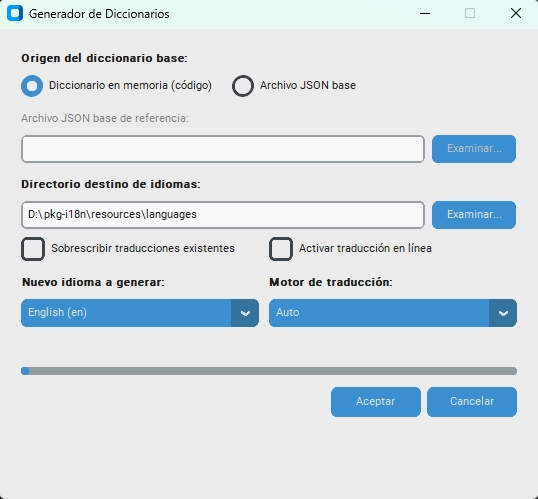

# 🌐 pkg-i18n

[🇪🇸 Español](README.md) | [🇺🇸 English](README.en.md)

[](LICENSE) [](https://www.python.org/) [](#-arquitectura-de-carga-en-cascada-7-capas--contingencia) [](#-instalación)

Este paquete proporciona una solución de **internacionalización  (i18n), localización (l10n)** completa, centralizada, extensible, de alto rendimiento y sin dependencias obligatorias para cualquier proyecto Python (aplicaciones de escritorio como PyQt/CustomTkinter, herramientas CLI, scripts o servidores web).

**pkg-i18n** es la infraestructura integral de internacionalización (i18n), localización (l10n), utilizada por las aplicaciones de la suite **Asisnet**.

--------------------------------------------------------------------------------


--------------------------------------------------------------------------------

#### 📋 Tabla de Contenidos

1. [🎯 ¿Por qué pkg-i18n? (Propósito e Intención)](#-por-qué-pkg-i18n-propósito-e-intención)
2. [🚀 Capacidades y Características Clave](#-capacidades-y-características-clave)
3. [📦 Instalación](#-instalación)
4. [🏗️ Arquitectura de Carga en Cascada (7 Capas) + Contingencia](#️-arquitectura-de-carga-en-cascada-7-capas--contingencia)
5. [📁 Estructura del Proyecto y Formato de Archivos JSON](#-estructura-del-proyecto-y-formato-de-archivos-json)
6. [🛠️ Guía Rápida para Desarrolladores](#️-guía-rápida-para-desarrolladores)
   - [Bloque I: Respaldo Base en Código (Capa 0 — Previo a Producción)](#bloque-i-respaldo-base-en-código-capa-0--previo-a-producción)
     - [1. Registro de Diccionario Base en Código (Capa 0)](#1-registro-de-diccionario-base-en-código-capa-0)
     - [2. Configuración y Resolución de Rutas de Idiomas](#2-configuración-y-resolución-de-rutas-de-idiomas)
   - [Bloque II: Operaciones en Producción (Tiempo de Ejecución)](#bloque-ii-operaciones-en-producción-tiempo-de-ejecución)
     - [3. Inicialización y Consumo Básico (`t18n`)](#3-inicialización-y-consumo-básico-t18n)
     - [4. Concurrencia Web, ContextVar y Aislamiento por Petición (FastAPI, Uvicorn, Flask, Hilos)](#4-concurrencia-web-contextvar-y-aislamiento-por-petición-fastapi-uvicorn-flask-hilos)
     - [5. Suscripción a Cambios en Tiempo Real (Patrón Observador)](#5-suscripción-a-cambios-en-tiempo-real-patrón-observador)
     - [6. Gestión y Listado de Idiomas Disponibles](#6-gestión-y-listado-de-idiomas-disponibles)
   - [Bloque III: Herramientas de Desarrollo y Utilidades](#bloque-iii-herramientas-de-desarrollo-y-utilidades)
     - [7. Extractor Sintáctico AST + Regex (`extract_base_language`)](#7-extractor-sintáctico-ast--regex-extract_base_language)
     - [8. Sincronización y Traducción Automática (`prepare_new_language`)](#8-sincronización-y-traducción-automática-prepare_new_language)
     - [9. Interfaz Gráfica: Generador de Diccionarios (`--ui`)](#9-interfaz-gráfica-generador-de-diccionarios---ui)
     - [10. Exportación del Diccionario Activo (`export_active_dictionary`)](#10-exportación-del-diccionario-activo-export_active_dictionary)
     - [11. Soporte para Empaquetado con PyInstaller](#11-soporte-para-empaquetado-con-pyinstaller)
7. [🌐 Interoperabilidad con Otros Lenguajes](#-interoperabilidad-con-otros-lenguajes)
8. [👥 Contacto y Soporte](#-contacto-y-soporte)
9. [📄 Licencia](#-licencia)

--------------------------------------------------------------------------------

#### 🎯 ¿Por qué pkg-i18n? (Propósito e Intención)
En el desarrollo de aplicaciones empresariales y de misión crítica, la gestión de textos multilingües suele convertirse en una  **tarea repetitiva, desorganizada y propensa a fallos** :
*   **Textos dispersos en código (hardcoded)** : Cadenas incrustadas directamente en la interfaz gráfica o lógica de negocio que dificultan auditorías, adaptaciones regionales y cambios de idioma.
*   **Dependencias pesadas y rígidas** : Herramientas tradicionales que requieren compilar catálogos binarios (.mo, .po) o atan los proyectos a dependencias complejas incompatibles con entornos ligeros o embebidos.
*   **Inconsistencias y caídas en tiempo de ejecución** : Ausencia de redes de contingencia deterministas ante claves ausentes en catálogos desactualizados, provocando errores no controlados frente al usuario.
*   **Corrupción al traducir automáticamente** : Pérdida de variables dinámicas ({user}), etiquetas HTML o URLs cuando se envían textos planos a motores de traducción externa.
*   **Aislamiento entre plataformas** : Dificultad para compartir un catálogo único de términos entre aplicaciones modernas en Python y sistemas empresariales consolidados en otros lenguajes (como .NET / VB.NET).
**pkg-i18n nace para erradicar definitivamente estos problemas** , proveyendo una solución  **llave en mano, modular, resiliente y de alto rendimiento** :
1.  **Resolución en 1 sola línea (t18n)** : Consulta inmediata con resolución por notación de puntos y red de contingencia transparente.
2.  **Carga en Cascada Multicapa (7 Capas + Contingencia)** : Permite sobreescribir desde diccionarios base en código hasta catálogos empaquetados y archivos editables externos por sucursal o usuario final, con una red de contingencia que garantiza cero interrupciones en producción.
3.  **Recurso Mínimo en Producción ($O(1)$)** : Consumo ultra liviano en memoria con `__slots__ = True`, despacho inmediato $O(1)$, carga bajo demanda (*lazy loading* vía PEP 562) y cero dependencias externas obligatorias (100% biblioteca estándar de Python).
4.  **Seguridad en Concurrencia Asíncrona y Multi-Hilo** : Aislamiento total del idioma por petición HTTP, tarea en background o hilo mediante `ContextVar` (`use_language`), permitiendo servir múltiples usuarios en diferentes idiomas simultáneamente en APIs y microservicios (FastAPI, Uvicorn, Flask, Celery) con caché multi-idioma en memoria sin condiciones de carrera.
5.  **Traducción Asistida Inteligente con Enmascaramiento Seguro** : Automatización de catálogos protegiendo variables, saltos de línea y sintaxis HTML contra alucinaciones o alteraciones externas.
6.  **Ecosistema Abierto e Interoperable** : Formato JSON estándar listo para ser consumido tanto en Python como en soluciones corporativas .NET / VB.NET.

--------------------------------------------------------------------------------

#### 🚀 Capacidades y Características Clave
*   **Recurso Mínimo y Autónomo en Producción** : Opera con huella mínima (*minimal footprint*) consumiendo exclusivamente la biblioteca estándar de Python (`json`, `re`, `logging`, `pathlib`). Al importar (`import i18n` o `from i18n import t18n`), solo se carga el motor esencial (`i18n.engine`) con memoria optimizada (`__slots__ = True`), garantizando cero sobrecarga y sin dependencias de terceros obligatorias en tiempo de ejecución.
*   **Seguridad en Concurrencia y Aislamiento por Contexto (`ContextVar`)** : Soporte nativo para servidores web asíncronos y arquitecturas concurrentes (FastAPI, Starlette, Uvicorn, Flask, Celery, ThreadPoolExecutor). Permite aislar el idioma por petición HTTP o corrutina sin mutar el estado global de la aplicación mediante `use_language()` y `set_context_language()`.
*   **Caché Multi-Idioma en Memoria ($O(1)$) y Consultas Dirigidas (`lang`)** : Retención en memoria de diccionarios resueltos por cada idioma (`_loaded_languages`), evitando lecturas redundantes a disco. Permite además consultar traducciones en idiomas específicos en $O(1)$ directo mediante el parámetro `lang` en `t18n("clave", lang="en")` sin alterar el idioma activo global.
*   **Registro Modular de Secciones (`register_section_defaults`)** : Registro granular de respaldos en código (Capa 0) por sección o módulo desacoplado sin necesidad de anidar diccionarios manualmente.
*   **Interfaz Gráfica Integrada: Generador de Diccionarios (`i18n --ui`)** : Entorno visual moderno e intuitivo (CustomTkinter) para crear, clonar y sincronizar diccionarios de idiomas con soporte para traducción automática mediante motores en línea (Google Translate —requiere conexión a Internet—) y motores locales offline (Argos Translate y clonación local sin conexión).
*   **Resolución Ultrarrápida en Cascada Jerárquica (7 Capas)** : Resuelve diccionarios en memoria combinando valores registrados en código (Capa 0), archivos base empaquetados (`es.json`), variantes regionales (`pt-BR.json`) y capas externas personalizables.
*   **Red de Contingencia en Runtime** : Si una clave no se encuentra en ninguna capa del catálogo, `t18n(clave, texto_defecto)` formatea y entrega el texto por defecto proporcionado, garantizando continuidad operativa absoluta.
*   **Acceso Directo con Notación de Puntos y Sección `_default`** : Soporta claves directas (ej. `t18n("btn_open")` resuelve `_default.btn_open`) y rutas modulares anidadas (ej. `t18n("modulo1.sec1.clave")`).
*   **Formateo Seguro de Parámetros Dinámicos** : Inyección de variables con sintaxis estándar (`"Bienvenido, {user}"`) con tolerancia y protección ante fallos de formato.
*   **Patrón Observador para Interfaces de Usuario** : Suscripción reactiva mediante `i18n.subscribe(callback)` para actualizar ventanas y vistas en tiempo real al conmutar el idioma sin reiniciar el aplicativo.
*   **Extractor Sintáctico AST + Regex (`extract_base_language`)** : Escanea el código fuente del proyecto para catalogar claves automáticamente y generar el diccionario base y auditoría de líneas (`es_source.json`).
*   **Traductor Automático con Enmascaramiento Antialucinación (`prepare_new_language`)** : Enmascara variables (`{user}`), etiquetas HTML y URLs con tokens numéricos seguros antes de invocar traductores externos (Google Translate / Argos Translate / Mock), restaurándolos íntegros en el destino.
*   **Soporte Nativo para Ejecutables PyInstaller** : Detección automática del entorno congelado (`sys._MEIPASS`) para localizar recursos empaquetados sin configuración adicional.
*   **Interoperabilidad con Ecosistemas .NET y VB.NET** : Arquitectura abierta para compartir catálogos y traducir software corporativo en múltiples lenguajes.

--------------------------------------------------------------------------------

#### 📦 Instalación
##### 1. Instalación Directa desde GitHub (Recomendado)
Instalación en el entorno virtual mediante pip:
```powershell
pip install git+https://github.com/borispinto/pkg-i18n.git

```
O declarándolo en tu archivo requirements.txt:
```text
pkg-i18n @ git+https://github.com/borispinto/pkg-i18n.git

```
O en tu archivo pyproject.toml:
```toml
[project]
dependencies = [
    "pkg-i18n>=1.0.0",
]

```

--------------------------------------------------------------------------------

##### 2. Instalación desde el Código Fuente Local
Clonación e instalación estándar:
```powershell
git clone https://github.com/borispinto/pkg-i18n.git
cd pkg-i18n
pip install .

```
O en modo editable para desarrollo:
```powershell
pip install -e .

```
>[!NOTE]  **Separación de Perfiles y Dependencias** :
>*  **Producción / Consumo en tiempo de ejecución (`t18n`)** : Opera como un **recurso mínimo con cero dependencias externas** (requiere únicamente Python 3.8+ y su biblioteca estándar).
>*  **Interfaz Gráfica (`--ui`) y Traducción Automática (Desarrollo / Herramientas)** :
>   *  Para lanzar la interfaz gráfica (`i18n --ui`): `pip install customtkinter pillow`
>   *  Para traducción asistida en línea con **Google Translate** (requiere conexión activa a Internet): `pip install deep-translator`
>   *  Para traducción asistida **100% offline** con **Argos Translate** (sin requerimiento de internet tras disponer de modelos): `pip install argostranslate`

--------------------------------------------------------------------------------

#### 🏗️ Arquitectura de Carga en Cascada (7 Capas) + Contingencia
El gestor I18nManager resuelve las traducciones evaluando 7 capas en orden jerárquico ascendente (cada capa superior sobreescribe a las anteriores si define la misma clave):
| Capa | Origen | Descripción |
| ------ | ------ | ------ |
| **0** | Código Python | Diccionario base en código, cargado mediante register_defaults() |
| **1** | Interno es.json | Idioma base empaquetado por defecto en la aplicación |
| **2** | Externo es.json | Archivo base en directorio externo editable por el usuario |
| **3** | Interno {lang_base}.json | Idioma base solicitado (ej. pt.json) |
| **4** | Externo {lang_base}.json | Archivo base externo (ej. pt.json de usuario) |
| **5** | Interno {lang_regional}.json | Idioma regional solicitado (ej. pt-BR.json) |
| **6** | Externo {lang_regional}.json | Archivo regional externo (ej. pt-BR.json de usuario) |
| 🟡  **Contingencia** | En código t18n('clave', 'texto') | Red de seguridad final en tiempo de ejecución: detecta inconsistencias del catálogo y garantiza continuidad operativa |


--------------------------------------------------------------------------------

#### 📁 Estructura del Proyecto y Formato de Archivos JSON
##### Estructura recomendada en tu proyecto consumidor
```text
mi_proyecto/
├── pyproject.toml / requirements.txt   # Declara dependencia a pkg-i18n
├── src/
│   ├── app.py                         # Código de tu aplicación
│   └── ...
└── resources/
    └── languages/                     # Ruta canónica para archivos de idioma
        ├── es.json                    # Idioma base
        ├── en.json                    # Idioma inglés
        ├── pt.json                    # Idioma secundario
        └── pt-BR.json                 # Variantes regionales

```
>[!NOTE] El motor de i18n detecta automáticamente la carpeta resources/languages tanto en la raíz de tu proyecto, en el directorio de trabajo actual (CWD), o empaquetada dentro de ejecutables PyInstaller.

##### Formato de Archivo JSON de Idioma
De acuerdo con las especificaciones del motor, las  **claves reservadas con prefijo _ en la raíz**  son:
*  _language_name: Utilizada para mostrar el nombre legible del idioma en selectores de la UI.
*  _default: Sección reservada para todas las claves generales/globales.
El ordenamiento estándar ubica primero _language_name, luego _default, y a continuación los módulos o subsecciones del proyecto ordenados alfabéticamente:
```json
{
    "_language_name": "Español",
    "_default": {
        "app_title": "Mi Aplicación Python",
        "btn_open": "Abrir",
        "btn_save": "Guardar",
        "msg_welcome": "Bienvenido, {user}"
    },
    "modulo1": {
        "sec1": {
            "campo_usuario": "Nombre de usuario",
            "valor_clave": "Valor en Sección 1"
        }
    }
}

```

--------------------------------------------------------------------------------

#### 🛠️ Guía Rápida para Desarrolladores

Esta guía organiza las capacidades de **pkg-i18n** en su secuencia lógica natural de ocurrencia:
1. **Bloque I: Respaldo Base en Código (Capa 0 — Previo a Producción)**: Asegura la resiliencia integral, la autonomía en arranque y sienta la base en memoria para generar nuevos diccionarios.
2. **Bloque II: Operaciones en Producción (Tiempo de Ejecución)**: Describe el consumo diario de textos, resolución de variables, concurrencia web y reactividad visual.
3. **Bloque III: Herramientas de Desarrollo y Utilidades**: Automatiza la extracción de cadenas, traducción asistida, herramientas gráficas y empaquetado.

--------------------------------------------------------------------------------

### Bloque I: Respaldo Base en Código (Capa 0 — Previo a Producción)

##### 1. Registro de Diccionario Base en Código (Capa 0)
###### ¿Por qué es necesario y altamente recomendable registrarlo antes de producción?
La **Capa 0** es el cimiento de la arquitectura de contingencia de **pkg-i18n**. Registrar el diccionario base directamente en código fuente mediante `register_defaults()` o `register_section_defaults()` proporciona ventajas deterministas críticas:
*   **Autonomía y Resiliencia Total**: Si los archivos `.json` externos no se despliegan, se borran accidentalmente por el usuario final o sufren restricciones de permisos de lectura en disco, la aplicación continúa ejecutándose con el 100% de sus textos base legibles y funcionales, garantizando cero pantallas rotas o textos vacíos.
*   **Cero Latencia de I/O en Arranque**: Los textos generales y críticos de la interfaz residen directamente en memoria desde la inicialización, sin esperas de lectura de disco ni sobrecarga de parseo JSON.
*   **Base en Memoria para Crear Nuevos Diccionarios**: El diccionario registrado opera como el `default_dict` en memoria que alimenta tanto al pipeline de sincronización (`prepare_new_language`) como a la interfaz visual (`i18n --ui`), permitiendo generar, clonar y traducir nuevos idiomas sin necesidad de depender de un archivo `.json` previo en disco.
*   **Práctica Canónica Pre-Release**: Antes de congelar ejecutables con PyInstaller o generar un despliegue a producción, se recomienda ejecutar el extractor (`extract_base_language`) y congelar las claves consolidadas en código como Capa 0.

```python
from i18n import get_i18n_instance, register_defaults, register_section_defaults

i18n = get_i18n_instance()

# 1. Registro global completo del catálogo base estructurado (Capa 0):
register_defaults({
    "_language_name": "Español",
    "_default": {
        "app_title": "Mi Aplicación Python",
        "btn_accept": "Aceptar",
        "btn_close": "Cerrar",
        "btn_continue": "Continuar"
    },
    "modulo1": {
        "clave_1": "Texto de la clave 1 del modulo1.",
        "clave_2": "Texto de la clave 2 del modulo1.",
    }
})

# 2. Registro granular por módulo desacoplado (directo o via función canónica):
register_section_defaults("auth", {
    "login": "Iniciar Sesión",
    "logout": "Cerrar Sesión",
    "btn_submit": "Enviar credenciales"
})
```

--------------------------------------------------------------------------------

##### 2. Configuración y Resolución de Rutas de Idiomas
`pkg-i18n` permite consultar y personalizar las rutas de directorios internos (recursos base empaquetados) y externos (archivos editables por el usuario final):

```python
from i18n import get_i18n_instance, resolve_languages_directory

# Resolver la ruta canónica activa (CWD, recursos de paquete o PyInstaller sys._MEIPASS):
ruta = resolve_languages_directory()

# Personalizar directorios internos y externos de idiomas:
i18n = get_i18n_instance()
i18n.set_internal_languages_dir("resources/languages")
i18n.set_external_languages_dir("external/languages")
```

--------------------------------------------------------------------------------

### Bloque II: Operaciones en Producción (Tiempo de Ejecución)

##### 3. Inicialización y Consumo Básico (t18n)
Puedes utilizar la función canónica `t18n()` en cualquier módulo o función de tu proyecto con resolución inmediata en $O(1)$:

```python
from i18n import t18n

# 1. Claves de la sección _default (ambas sintaxis son equivalentes y resuelven en O(1)):
texto_boton = t18n("btn_open", "Abrir")
texto_guardar = t18n("_default.btn_save", "Guardar")

# 2. Claves de secciones anidadas o compuestas:
titulo_sec = t18n("modulo1.sec1.valor_clave", "Valor por Defecto")

# 3. Inyección segura de variables dinámicas:
mensaje = t18n("msg_welcome", "Bienvenida, {user}", user="Dayana")

# 4. Control de marcadores de fallback (<Texto Defecto>) en claves inexistentes:
# Por defecto, una clave inexistente retorna '<Texto Defecto>' para alertar al desarrollador.
# Para suprimir los marcadores '< >' y obtener el texto limpio:
texto_limpio = t18n("msg_welcome", "Bienvenida, {user}", user="Dayana", suppress_markers=True)

# 5. Consulta directa en un idioma específico (sin alterar el contexto ni el idioma global):
# Resuelve 'btn_open' desde el catálogo en.json ('Open'); si no existe, entrega el texto base 'Abrir':
texto_en = t18n("btn_open", "Abrir", lang="en")
```

>[!NOTE] **Acceso Directo y Verificación de Claves**:
>`I18nManager` implementa compatibilidad de acceso estilo diccionario para verificar la presencia de claves o consultar valores en crudo:
>```python
>from i18n import get_i18n_instance
>i18n = get_i18n_instance()
>
># Verificación de existencia (O(1)):
>if "btn_open" in i18n:           # o i18n.has_key("btn_open")
>    print(i18n["btn_open"])      # Acceso por corchetes (genera KeyError si no existe)
>    print(i18n.get("btn_open"))  # Acceso seguro sin formateo
>```
>**Recomendación de Producción**: Se recomienda utilizar siempre la función canónica `t18n()`, ya que a diferencia del acceso directo, provee formateo tolerante de parámetros dinámicos, evaluación de la red de contingencia de 7 capas, respeto a las variables de contexto (`ContextVar`) y supresión controlada de marcadores de depuración.

--------------------------------------------------------------------------------

##### 4. Concurrencia Web, ContextVar y Aislamiento por Petición (FastAPI, Uvicorn, Flask, Hilos)
###### ¿Para qué sirve?
En arquitecturas web, APIs REST, microservicios y workers asíncronos (FastAPI, Starlette, Uvicorn, Flask, Celery, ThreadPoolExecutor), un único proceso atiende múltiples solicitudes concurrentes en paralelo para usuarios con diferentes preferencias de idioma. Modificar el idioma global de la aplicación (`set_language(...)`) mutaría el estado para todos los usuarios concurrentes, provocando condiciones de carrera (*race conditions*) y entregando textos en idiomas incorrectos.

`pkg-i18n` proporciona una solución nativa basada en **variables de contexto (`contextvars.ContextVar`)**, garantizando que cada corrutina asíncrona o hilo de ejecución conserve su propio idioma activo de forma estrictamente aislada, sin colisiones ni fugas de memoria.

###### ¿Cómo hacer uso de ella?

1. **Context Manager `use_language` (Bloques Delimitados)**:
   Permite aislar temporalmente un idioma en cualquier tarea, hilo o bloque de código:
   ```python
   from i18n import t18n, use_language

   # use_language("en") resuelve la clave 'btn_open' desde el catálogo en.json ('Open'):
   with use_language("en"):
       print(t18n("btn_open", "Abrir"))
   ```

2. **Middlewares HTTP para Servidores Web (FastAPI / Starlette / Uvicorn)**:
   Detecta el idioma preferido en cada petición HTTP (por ejemplo, desde la cabecera `Accept-Language` o parámetros de consulta) y lo asocia al contexto de la corrutina:
   ```python
   from fastapi import FastAPI, Request
   from i18n import set_context_language, reset_context_language, t18n

   app = FastAPI()

   @app.middleware("http")
   async def i18n_middleware(request: Request, call_next):
       # Extraer el código base del idioma (ej: 'en', 'es', 'pt')
       lang_header = request.headers.get("accept-language", "es")
       lang_code = lang_header.split(",")[0].split("-")[0].strip()

       # Fijar el idioma en el ContextVar de la tarea actual
       token = set_context_language(lang_code)
       try:
           response = await call_next(request)
           return response
       finally:
           # Restablecer limpiamente el contexto al culminar la petición
           reset_context_language(token)

   @app.get("/bienvenida")
   async def bienvenida(nombre: str = "Usuario"):
       # Resuelve automáticamente en el idioma asignado a la petición actual:
       return {"mensaje": t18n("msg_welcome", "Bienvenido, {user}", user=nombre)}
   ```

3. **Aislamiento en Hilos (`ThreadPoolExecutor`)**:
   ```python
   from concurrent.futures import ThreadPoolExecutor
   from i18n import t18n, use_language

   def tarea_ingles():
       # use_language("en") resuelve 'btn_open' desde en.json ('Open')
       with use_language("en"):
           return t18n("btn_open", "Abrir")

   def tarea_espanol():
       # use_language("es") resuelve 'btn_open' desde es.json ('Abrir')
       with use_language("es"):
           return t18n("btn_open", "Abrir")

   with ThreadPoolExecutor(max_workers=2) as executor:
       hilo_en = executor.submit(tarea_ingles)
       hilo_es = executor.submit(tarea_espanol)
       print(f"Resultado EN: {hilo_en.result()} | ES: {hilo_es.result()}")
   ```

>[!TIP] **Recomendación para el Extractor Sintáctico AST (`extract_base_language`)** :
>En llamadas a `t18n(clave, texto_defecto)`, se recomienda utilizar de forma consistente el texto de respaldo correspondiente al idioma base (ej: `"Abrir"`), incluso al trabajar bajo bloques `use_language("en")` o con el parámetro `lang="en"`. El motor de `pkg-i18n` resolverá la traducción en el idioma destino desde el catálogo correspondiente en memoria; mantener el mismo texto por defecto en todo el código previene discrepancias y asegura que la herramienta de extracción genere un catálogo base (`es.json`) limpio, unificado y determinista.

4. **Jerarquía Determinista de Resolución ($O(1)$)**:
   Al consultar `t18n(key, ...)` o verificar `has_key(key, ...)`, la resolución opera en tiempo constante $O(1)$ evaluando las fuentes en estricto orden de precedencia:
   1. **Parámetro explícito `lang`**: Si se especifica `t18n(..., lang="fr")`, consulta directamente el catálogo de dicho idioma.
   2. **Contexto Activo (`ContextVar`)**: Si existe un idioma fijado mediante `use_language()` o `set_context_language()`, resuelve en este catálogo.
   3. **Idioma Activo Global (`self.active_dictionary`)**: El idioma configurado con `set_language(...)` (ideal para aplicaciones de escritorio y CLI).
   4. **Red de Contingencia**: Si la clave no existe en ningún catálogo, retorna el `default_text` formateado.

5. **Caché Multi-Idioma en Memoria ($O(1)$) y `clear_cache()`**:
   - `_loaded_languages`: `I18nManager` retiene en memoria cada diccionario resuelto a través de las 7 capas. Una vez compilado, todas las consultas posteriores resuelven directamente en $O(1)$ sin acceder a disco.
   - Si se modifican archivos `.json` en caliente en el sistema de archivos, puedes purgar el almacén en memoria invocando `clear_cache()` para forzar su recarga inmediata:
     ```python
     from i18n import clear_cache

     # Limpia el caché en memoria de diccionarios precargados
     clear_cache()
     ```

--------------------------------------------------------------------------------

##### 5. Suscripción a Cambios en Tiempo Real (Patrón Observador)
Para aplicaciones con interfaz gráfica (CustomTkinter, PyQt, PySide, Tkinter, WxPython), puedes suscribir funciones para refrescar automáticamente la interfaz cuando el usuario cambie el idioma:
```python
from i18n import get_i18n_instance, t18n

i18n = get_i18n_instance()

def al_cambiar_idioma(nuevo_codigo_idioma: str):
    print(f"El idioma cambió a: {nuevo_codigo_idioma}")
    # Actualizar textos de la interfaz gráfica
    lbl_titulo.configure(text=t18n("app_title", "Mi Aplicación"))
    btn_abrir.configure(text=t18n("btn_open", "Abrir"))

# Suscribir callback
i18n.subscribe(al_cambiar_idioma)

# Al cambiar de idioma, `al_cambiar_idioma` se ejecutará automáticamente:
i18n.set_language("pt-BR")

```

--------------------------------------------------------------------------------

##### 6. Gestión y Listado de Idiomas Disponibles
Para alimentar selectores o combos desplegables en la interfaz gráfica:
```python
from i18n import get_i18n_instance

i18n = get_i18n_instance()

# Obtener lista de dicts: [{'code': 'es', 'name': 'Español'}, ...]
idiomas_lista = i18n.get_available_languages()

# Obtener mapeo para combos por nombre: {'Español': 'es', 'Português (Brasil)': 'pt-BR'}
idiomas_dict = i18n.get_available_languages(by_name=True)

```

--------------------------------------------------------------------------------

### Bloque III: Herramientas de Desarrollo y Utilidades

##### 7. Extractor Sintáctico AST + Regex (extract_base_language)
Escanea el código fuente de tu proyecto buscando llamadas a `t18n()` y genera o actualiza el archivo `es.json` conservando y ordenando las claves. Si no se especifica `output_dir`, se ubica automáticamente en `resources/languages` relativo a `origin_dir`:
```python
from i18n import extract_base_language

resultado = extract_base_language(
    origin_dir="src",                      # Carpeta o archivo fuente a escanear
    output_dir=None,                       # Opcional (por defecto: src/resources/languages)
    file_extensions=[".py", ".html"],      # Extensiones a escanear
    recursive=True,                        # Escanear subdirectorios
    function_names=["t18n"],               # Nombres de funciones a detectar
    language_name="Español",
    target_filename="es.json",
    show_source=True                       # Genera es.json estándar Y adicionalmente es_source.json
)

print(resultado)
# {
#   'status': 'success',
#   'target_file': '.../resources/languages/es.json',
#   'source_file': '.../resources/languages/es_source.json',
#   'total_extracted': 15,
#   ...
# }
```
>[!TIP] **Generación dual con show_source=True**:
>1. `es.json` (Producción): Contiene las cadenas limpias para producción (`"btn_open": "Abrir"`).
>2. `es_source.json` (Auditoría / Desarrollo): Contiene el valor y el mapeo de fuentes por programa y números de línea:
>```json
>"btn_open": {
>    "valor": "Abrir",
>    "source": {
>        "src/gui/main_window.py": [50, 520],
>        "src/gui/second_window.py": [3, 8, 25]
>    }
>}
>```

--------------------------------------------------------------------------------

##### 8. Sincronización y Traducción Automática (prepare_new_language)
Crea o sincroniza plantillas para otros idiomas (ej. `en.json`, `pt.json`, `fr.json`) a partir del idioma base `es.json` o del diccionario base en memoria (`default_dict`). Si no se indica `target_dir`, se resuelve automáticamente mediante `resolve_languages_directory()`:
```python
from i18n import prepare_new_language

# Ejemplo 1: Traducción automática usando Google Translate (requiere deep-translator y conexión a internet)
resultado = prepare_new_language(
    target_code="fr",
    target_name="Français",
    default_dict={},                      # Diccionario opcional si no hay es.json
    base_code="es",
    target_dir=None,                      # Opcional (por defecto resources/languages)
    auto_translate=True,                  # Traducir automáticamente textos ausentes
    engine="auto"                         # Opciones: 'auto', 'google', 'argos', 'none', 'mock'
)

# Ejemplo 2: Generar plantilla base sin traducción externa (offline/local, clonación estructurada)
resultado_offline = prepare_new_language(
    target_code="en",
    target_name="English",
    auto_translate=False,
    engine="none"
)
```

--------------------------------------------------------------------------------

##### 9. Interfaz Gráfica: Generador de Diccionarios (`--ui`)
`pkg-i18n` incorpora una interfaz gráfica interactiva y asistida para la creación, clonación y sincronización de diccionarios de idiomas sin necesidad de editar manualmente archivos JSON.



###### Características de la Interfaz:
*   **Selector Dinámico de Origen Base**: Permite alternar entre el diccionario cargado en memoria desde código (`default_dict`) o seleccionar interactivamente un archivo JSON base existente en disco.
*   **Selección Normalizada de Idioma Destino**: Catálogo integrado de idiomas con códigos y nombres legibles estandarizados.
*   **Soporte para Múltiples Motores y Conectividad**:
    *   **Google Translate (`google` / `auto`)**: Traducción neuronal de alta precisión. **Requiere conexión activa a Internet**.
    *   **Argos Translate (`argos`)**: Inferencia neuronal basada en CTranslate2 con modelos locales (`languages/argos`). **100% offline** (no requiere internet una vez descargados los paquetes de idiomas).
    *   **Clonación Estructurada (`none`)**: Duplica la estructura del catálogo base preservando los textos para posterior traducción o revisión manual. **100% offline** y sin dependencias externas.
*   **Armonía Visual y Temas**: Desarrollada sobre CustomTkinter, adopta automáticamente modos claro/oscuro y temas personalizados.

###### Lanzamiento desde Línea de Comandos (CLI):
```powershell
# Lanzar la interfaz en modo autónomo
i18n --ui

# Lanzar especificando directorio destino y archivo base inicial
i18n --ui --target-dir resources/languages --base resources/languages/es.json

# Ejecutar como módulo con Python
python -m i18n --ui
```

###### Invocación Programática desde Código Python:
Puede integrarse directamente dentro de aplicaciones de escritorio (PyQt, CustomTkinter, Tkinter, etc.) como ventana subordinada (`modal`) o como ventana principal autónoma:

```python
from i18n import launch_new_language_dialog

# Lanzar como ventana principal autónoma o modal integrada
dialogo = launch_new_language_dialog(
    parent=None,                                # None para ventana autónoma, o root / toplevel padre
    target_dir="resources/languages",          # Carpeta donde se guardará el nuevo idioma
    base_code="es",                            # Código del idioma base de referencia
    base_file="resources/languages/es.json",   # Ruta opcional al archivo JSON base en disco
    default_dict=mi_diccionario_en_codigo,     # Diccionario base en memoria (Capa 0 en código)
    icon_path="assets/icono.ico",               # Icono de la ventana
    theme="blue",                              # Tema de color CustomTkinter ('blue', 'green', etc.)
    appearance_mode="dark",                    # Modo de apariencia ('dark', 'light', 'system')
    font_family="Segoe UI",                    # Tipografía general
    font_size=11,                              # Tamaño de fuente base (escala proporcionalmente)
    fonts=None,                                # Diccionario granular de tipografías por rol
    colors=None,                               # Diccionario granular de colores para paleta UI
    on_success=lambda path: print(f"Creado: {path}"),  # Callback ejecutado tras crear el archivo
    on_error=lambda err: print(f"Error: {err}")        # Callback ante excepciones
)
```

###### Referencia Exhaustiva de Parámetros (`launch_new_language_dialog`):

| Parámetro | Tipo | Valor por Defecto | Descripción |
| :--- | :--- | :--- | :--- |
| `parent` | `Optional[Any]` | `None` | Ventana padre (`Tk`, `CTk` o `CTkToplevel`). Si es `None`, se instancia como ventana principal independiente (`CTk`) con su propio bucle de eventos (`mainloop`). Si se proporciona, opera como modal subordinado centrado sobre el padre (`transient` / `grab_set`). |
| `target_dir` | `Optional[str]` | `None` | Directorio destino para los diccionarios `.json`. Si se omite, se resuelve automáticamente mediante `resolve_languages_directory()`. |
| `base_code` | `Optional[str]` | `None` | Código del idioma base de referencia (ej. `"es"`). Por defecto adopta el idioma base configurado en la instancia global de `i18n`. |
| `base_file` | `Optional[str]` | `None` | Ruta al archivo `.json` del idioma base existente. Si se suministra, activa por defecto la opción de "Archivo JSON base". |
| `default_dict` | `Optional[Dict[str, Any]]` | `None` | Diccionario base en memoria (Capa 0 en código). Si se suministra, habilita la opción "Diccionario en memoria (código)" permitiendo traducir directamente sin necesidad de un archivo previo en disco. |
| `icon_path` | `Optional[str]` | `None` | Ruta al archivo de icono (`.ico`) para la barra de título de la ventana. |
| `theme` | `Optional[str]` | `None` | Tema de color de CustomTkinter (ej. `"blue"`, `"dark-blue"`, `"green"` o ruta a un archivo `.json` de tema personalizado). |
| `appearance_mode` | `Optional[str]` | `None` | Modo de apariencia: `"dark"`, `"light"` o `"system"`. Si se omite, hereda el modo activo de la aplicación anfitriona. |
| `font_family` | `Optional[str]` | `None` | Familia tipográfica para los textos de la interfaz (ej. `"Segoe UI"`, `"Roboto"`, `"Arial"`). Si se omite, adopta la tipografía configurada en el tema activo sin forzar valores fijos. |
| `font_size` | `Optional[int]` | `11` | Tamaño de fuente base en puntos. Escala armónicamente títulos, etiquetas, campos y botones. |
| `fonts` | `Optional[Dict[str, Any]]` | `None` | Diccionario de personalización granular de fuentes por rol (`"title"`, `"label"`, `"body"`, `"entry"`, `"button"`, `"status"`), admitiendo instancias `CTkFont` o tuplas `(familia, tamaño, peso)`. |
| `colors` | `Optional[Dict[str, Any]]` | `None` | Diccionario de colores específicos para sobreescribir la paleta visual (`"text_primary"`, `"text_muted"`, `"btn_accept_fg"`, `"btn_cancel_fg"`, `"btn_browse_fg"`, `"progressbar_fg"`). |
| `on_success` | `Optional[Callable[[str], None]]` | `None` | Callback invocado al generar exitosamente el nuevo archivo de idioma, recibiendo como argumento la ruta absoluta del archivo generado (`file_path`). Permite actualizar selectores de idiomas o abrir el explorador de archivos automáticamente. |
| `on_error` | `Optional[Callable[[Exception], None]]` | `None` | Callback invocado en caso de error o excepción durante la generación o traducción. |

--------------------------------------------------------------------------------

##### 10. Exportación del Diccionario Activo (export_active_dictionary)
Permite volcar a un archivo JSON el diccionario consolidado en memoria (`active_dictionary`) tal cual está resuelto tras aplicar todas las capas:
```python
from i18n import export_active_dictionary, get_i18n_instance

# 1. Exportar con ruta por defecto ('dictionary.json' en el directorio de trabajo actual):
archivo_generado = export_active_dictionary()

# 2. Exportar especificando una carpeta de destino:
archivo_generado = export_active_dictionary("ruta/a/mi_carpeta/")

# 3. Exportar con ruta y nombre de archivo específico:
archivo_generado = export_active_dictionary("ruta/a/mi_carpeta/activo_en.json")

# O directamente desde la instancia de I18nManager:
i18n = get_i18n_instance()
i18n.export_active_dictionary("mi_diccionario.json")
```

--------------------------------------------------------------------------------

##### 11. Soporte para Empaquetado con PyInstaller
El módulo detecta automáticamente si la aplicación se ejecuta dentro de un ejecutable congelado con PyInstaller (sys._MEIPASS).
Al generar el ejecutable con PyInstaller, incluye la carpeta canónica de recursos de idioma con la opción --add-data:
```bash
pyinstaller --noconfirm --onedir --windowed --add-data "resources/languages;resources/languages" src/main.py

```

--------------------------------------------------------------------------------

#### 🌐 Interoperabilidad con Otros Lenguajes
Dado que **pkg-i18n** gestiona sus recursos lingüísticos en archivos de formato estándar JSON y expone herramientas modulares, es totalmente factible interoperar o compartir los catálogos de traducción con aplicaciones desarrolladas en otros lenguajes o plataformas (tales como .NET, VB.NET, C#, JavaScript o microservicios), ya sea consumiendo directamente los archivos `.json` generados o invocando los procesos de extracción y sincronización de forma desacoplada.

--------------------------------------------------------------------------------

#### 👥 Contacto y Soporte
Este proyecto es desarrollado y mantenido por  **Boris Pinto**, en colaboración con  **Asisnet Computación, CA** .
##### 🛠️ Autoría y Marca Personal
Si deseas colaborar en proyectos de código abierto o conectar profesionalmente:
*   **Desarrollador:**  Boris Pinto
*   **Correo Personal:**  [borispinto@gmail.com](mailto:borispinto@gmail.com)
*   **GitHub Profile:**  [@borispinto](https://github.com/borispinto)
##### 🏢 Soluciones Empresariales y Conectividad
¿Necesitas adaptar esta herramienta a tu negocio, requieres soporte técnico corporativo o buscas una infraestructura tecnológica a la medida? En  **Asisnet Computación, CA**  integramos software y hardware para optimizar tu operación.
*   **Nuestros Servicios:**
    *   **Software Administrativo:**  Sistemas a la medida para la gestión y control de tu negocio.
    *   **Redes y Comunicaciones:**  Diseño, instalación y soporte técnico para redes, infraestructura y conectividad.
    *   **Equipos Tecnológicos:**  Venta, soporte y mantenimiento de equipos.
*   **Contacto Comercial:**  ([proyectos@asisnet.net](mailto:proyectos@asisnet.net))

--------------------------------------------------------------------------------

#### 📄 Licencia
Este proyecto está bajo la Licencia [MIT](LICENSE). Es software libre y de código abierto, totalmente autorizado para su uso, modificación e integración en soluciones comerciales y empresariales.

Copyright (c) 2026 Boris Pinto. Todos los derechos reservados.